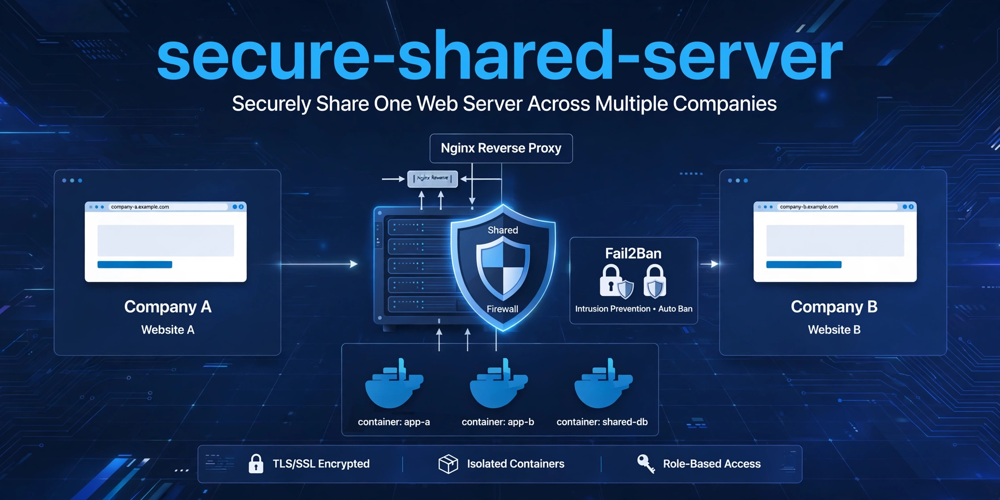

# secure-shared-server

Secure two companies sharing one web server. Docker isolation, Nginx, Fail2Ban, firewall and limits to stop cross-site attacks and noisy neighbour slowdowns.

## What it does
- Company A and Company B are in separate Docker containers
- They cannot see each other's files or database
- CPU / RAM limits stop one company slowing the other
- Nginx routes traffic to the correct company
- Fail2Ban blocks brute-force logins
- UFW firewall only opens 80, 443, 22

## Tools used
- Docker + Docker Compose
- Nginx
- Fail2Ban
- UFW
- ClamAV
- Let's Encrypt

## Quick start
```bash
git clone https://github.com/Johannesmoloi/secure-shared-server.git
cd secure-shared-server
cp .env.example .env
bash secure-server.sh
docker compose up -d
